### Hey, I'm Isaac

Electrical & Computer Engineering student at UC Santa Cruz, working toward EE. I like building things that sit between hardware and software, and I'm into cars, which is why my profile is a dashboard.

**What I'm working on**

- **FaultClaw** · adversarial hardware verification, built at a UCSC × NVIDIA hackathon
- **[gtr-mfd](https://github.com/IsaacH-2/gtr-mfd)** · the display above. It redraws every night from my GitHub activity; put one on your own profile in two steps

How to read the screen: <b>Boost</b> is my commit streak · <b>Oil temp</b> is open issues · <b>Fuel</b> is my last 30 days vs. my yearly pace · <b>G-meter</b> is my language mix · <b>Lap timer</b> is time between merged PRs.
